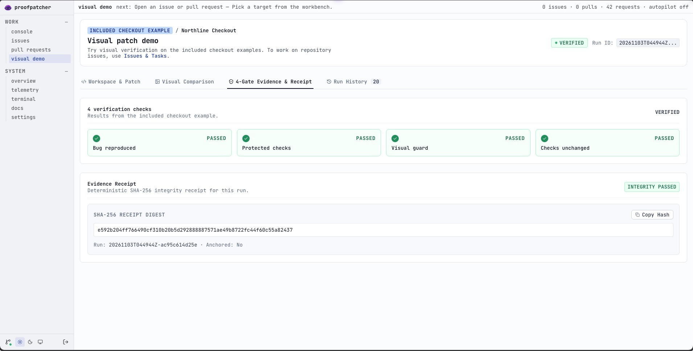

# ProofPatcher

**Muse proposes. ProofPatcher checks. You decide.**

A patch can look right and still miss the problem. ProofPatcher brings code review, focused repair suggestions and evidence into one local workspace, so maintainers can see what a change actually passed.

Built with Meta Muse for the **Meta Global AI Developer Hackathon 2026**.

## Meet Patcher

- **Review pull requests.** Connect GitHub, inspect changes and ask Muse for a review. Opt-in automatic reviews can run while the local worker is active.
- **Check a fix.** Try a checkout repair in the visual demo and see whether the checks catch a damaging shortcut.
- **Follow the evidence.** Inspect results and a receipt for the tested change. The included fixture also supports a focused issue-to-draft workflow on a configured test repository.



*The screenshot shows a manual repair of the included checkout example.*

## Get started

You'll need Git, PHP 8.4+ with `gd`, `json` and SQLite support, Composer, Node.js 20+ and npm. The visual demo also needs Chrome or Chromium.

ProofPatcher uses Laravel, Inertia, React and TypeScript. Composer installs Laravel and the PHP packages; npm installs the frontend packages, including TypeScript. You don't need to install Laravel or TypeScript separately. PIE is only needed if you want the interactive terminal below.

For a fresh installation:

```bash
git clone https://github.com/prateekbhujel/ProofPatcher.git
cd ProofPatcher
composer install
npm ci
cp .env.example .env
php artisan key:generate
touch database/proofpatch.sqlite
php artisan migrate
npm run build
php artisan serve --host=127.0.0.1 --port=8000
```

Open [localhost:8000](http://127.0.0.1:8000), connect your GitHub App and choose a model provider in Settings. Baseten serves Meta's Muse Spark Open; Meta Model API offers Muse directly. Configure the key for the provider you choose. For setup details, existing installations, the terminal and test commands, see the [local guide](docs/LOCAL_GUIDE.md).

For the isolated issue-repair fixture, you'll also need Python and a configured Modal account. The [fixture guide](docs/FIXTURE_ORACLE.md#trying-it-locally) explains that optional setup. The checkout visual demo uses PHP and a browser instead.

### Prefer the terminal?

The interactive terminal uses [php-terminal](https://github.com/prateekbhujel/php-terminal). Install the extension with [PIE](https://github.com/php/pie), then start Patcher:

```bash
pie install 'prateekbhujel/php-terminal:^1.0'
php --ri terminal
php artisan kernel
```

The extension is for the interactive terminal; the web app does not need it. See the extension's repository for platform-specific installation details.

## How it fits together

ProofPatcher is the workspace. **Hari** is its reusable coordination core: it brings the available abilities and skills together. Muse supplies reviews and suggestions; GitHub provides repository context and permitted actions; the configured verifier runs supported checks.

The kernel and OS names describe the design: Hari is an in-process PHP registry, and ProofPatcher is the application built on it. [Explore Hari](docs/HARI_KERNEL.md) · [Autopilot](docs/MAINTAINER_AUTOPILOT.md) · [Fixture checks](docs/FIXTURE_ORACLE.md)

## What to know

ProofPatcher is an early local prototype. Automatic PR reviews are opt-in, run only while the local worker is active, and currently cover eligible public repositories. Model findings need review.

The visual demo uses included examples. The isolated issue-to-draft flow is limited to a pinned test fixture; passing its cases does not prove a change is correct or safe in general. A fresh run from a new Muse proposal through live draft creation has not yet been demonstrated. Automatic merging requires explicit opt-in and strict branch protection, and has not been demonstrated live. [See the tested scope and safeguards](docs/LOCAL_GUIDE.md#scope-and-safeguards).

## License

[MIT](LICENSE)
