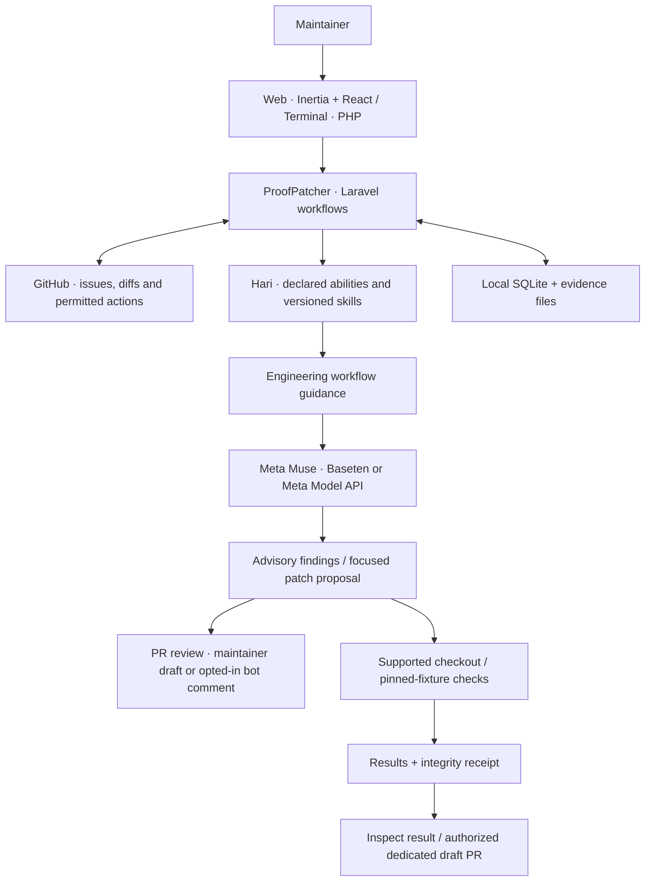

# ProofPatcher

**Muse proposes. ProofPatcher checks. Maintainers decide.**

A patch can look right and still be wrong. Maintainers need to understand the change, reproduce the problem, and see what the proposed fix actually passed.

ProofPatcher brings Meta Muse reviews, focused repair proposals, verification evidence and controlled GitHub actions into one local workspace. Its strongest demonstration is a checkout repair that Muse proposes and the browser-based verifier checks, including a damaging shortcut that the checks reject.

Built for the **Meta Global AI Developer Hackathon 2026** (26 October – 4 November 2026), Indie Developer track.

## See it work

1. **Inspect a public pull request.** Read the diff and Muse's findings, then edit an inline draft. Opt-in automatic review can handle new revisions while its local worker runs.
2. **Check a checkout repair.** In **Visual demo**, generate a patch with Muse, run verification and inspect the recorded model and check results. The bundled damaging shortcut demonstrates rejection. The included checkout is a controlled example, separate from arbitrary GitHub PRs.
3. **Inspect the evidence.** The receipt records the tested candidate and results. Its digest lets you check that the saved evidence has not changed.


*A manual preset passing the controlled checkout checks. Muse requests require your own configured provider key.*

## What it does today

- **Connect GitHub** to browse repositories, issues, pull requests, and existing GitHub checks within the app's grant.
- **Review pull requests with Muse.** Opt-in autopilot polls enabled public repositories, saves findings, and skips revisions it already reviewed. A separate opt-in permits an automated inline comment on eligible public repositories. A maintainer can also request a review with a mention while the local mention listener is running. Bot comments require GitHub App credentials.
- **Triage issues.** On enabled public repositories, the local worker can flag missing details, possible duplicates and related pull requests. A dedicated demo issue can be marked eligible for the separate fix workflow; that flag does not start a repair. See [Maintainer autopilot](docs/MAINTAINER_AUTOPILOT.md).
- **Control merges.** Manual merge and close require confirmation. An owner can opt in to automatic merging for a public repository with strict GitHub branch protection; automatic ready and close are unavailable.
- **Work with issues and tasks.** Save local task cards, inspect supported issue content, and request suggestions in the available workflows. Attached screenshots are stored locally; they are not interpreted by Muse in this workflow.
- **Check a supported patch.** A visual verifier exercises included checkout examples. On the dedicated test repository, a Muse proposal can run isolated fixture checks and then become a draft pull request; an identical existing draft is linked instead of duplicated. See [Isolated fixture checks](docs/FIXTURE_ORACLE.md).
- **Use the terminal.** The interactive menu and direct Artisan commands share connection state with the web app. The read-only local MCP server exposes usage, saved review results and receipt checks.
- **Reuse engineering skills.** Hari resolves a declared `engineering.workflow` skill for PR reviews, issue suggestions and task proposals. It guides Muse toward concrete evidence, relevant edge cases and focused fixes; the existing verifier supplies test results.

Model findings are suggestions: review them before acting. The application is an early local prototype, not a production service.

Large public pull requests can exceed the review limits. When a complete captured file is available, a maintainer can request a review of that file alone; the result identifies the limited scope and is not a review of the whole pull request. Some files may be unavailable when the captured diff exceeds the size limit.

## Architecture




**Hari** is the reusable coordination core beneath ProofPatcher. Abilities declare what they provide and borrow; the registry checks skill versions and capabilities before resolving them. The “OS on a kernel” description is a product analogy: the implementation is an in-process PHP registry. Execution isolation belongs to the configured runner. See [Hari's design and boundaries](docs/HARI_KERNEL.md).

The source follows the workflow:

| Directory | Responsibility |
| --- | --- |
| `app/Hari`, `app/Abilities` | Registry, ability manifests and skill implementations |
| `app/Application` | Workflow inputs, decisions and use cases |
| `app/Agent`, `app/GitHub` | Model requests and GitHub integrations |
| `app/Verifier`, `app/Evidence` | Supported checks and evidence integrity |
| `app/Http`, `app/Console` | Web and terminal entry points |
| `resources/js` | React pages and workflow components |
| `tests` | Regression, negative-control and integration checks |

## Run locally

### Requirements

- PHP 8.4 or newer, with `gd`, `json`, SQLite, and the extensions required by Laravel and Composer.
- Composer, Node.js 20 or newer, and npm.
- Chrome or Chromium for the visual verification examples.
- The PHP `terminal` extension and an interactive terminal for `php artisan kernel`. A plain menu is available when ANSI color is disabled.

For a **new installation**, from the repository directory:

```bash
composer install
npm ci
cp .env.example .env
php artisan key:generate
touch database/proofpatch.sqlite
php artisan migrate
npm run build
php artisan serve --host=127.0.0.1 --port=8000
```

Open [http://127.0.0.1:8000](http://127.0.0.1:8000). For an existing installation, keep its `.env` and application key, and back up the SQLite database before migrations. Rolling back task-card migrations deletes those cards or their screenshots.

Run evidence and saved PR snapshots stay in `storage/app/private/proofpatch`, outside the public web directory and excluded from Git by the existing storage rule.

### Connect GitHub

Configure a GitHub App with a client ID and client secret, enable device flow for terminal use, and install the app on the repositories you want to access. For local web sign-in, register `http://127.0.0.1:8000/github/callback` as a callback URL, or use the callback corresponding to your configured `APP_URL`.

Set `PROOFPATCH_GITHUB_CLIENT_ID` and `PROOFPATCH_GITHUB_CLIENT_SECRET` in your private `.env`. Do not commit credentials. Choose **Sign in with GitHub** in the web app; the terminal uses GitHub's device authorization flow.

In **Settings → Provider**, select Baseten or Meta Model API and add that provider's key. Alternatively, set `BASETEN_API_KEY` or `META_MODEL_API_KEY` in your private `.env`, restart the app, and select the corresponding provider in Settings. Baseten is selected by default; adding a Meta key does not switch providers automatically. Laravel does not load `.env` when configuration is cached, so use an uncached configuration or set the variables in the process environment. Never commit keys or put them in screenshots.

Model requests may consume provider credits or incur charges; the local usage ledger is an estimate, not a provider billing limit. An optional `PROOFPATCH_MODEL_MAX_ATTEMPTS` setting limits local request attempts; autopilot also has optional limits in Settings.

### Terminal

```bash
# Open the interactive menu (requires the PHP terminal extension)
php artisan kernel

# Or use individual commands
php artisan github:connect
php artisan kernel:status
php artisan kernel:select-repo --list
php artisan kernel:reviews
```

To search committed code in local Git repositories without sending it to a model:

```bash
php artisan kernel:context 'OrderTotal' --content --repo=/path/to/first --repo=/path/to/second
```

Search uses each repository's current commit by default. It shows at most one matching line per file and 25 files per repository; source lines may contain sensitive data. Omit `--content` to search file paths only. The terminal menu also offers local code search. This is a search tool, not persistent memory or context automatically sent to Muse.

To run a bounded automatic-review cycle, enable review for an authorized **public** repository and then run:

```bash
php artisan kernel:select-repo --enable-review owner/repository
php artisan kernel:autopilot --repo=owner/repository --minutes=1 --max-cycles=1
```

The worker runs only while the local machine and process are running. Automatic review does not process private pull requests. Automatic inline commenting requires its own explicit setting; enabling review alone does not enable comments. Bot posting additionally requires `PROOFPATCH_GITHUB_APP_ID` and an owner-only private key file outside the repository, referenced by `PROOFPATCH_GITHUB_APP_PRIVATE_KEY_PATH`. If the bot is not configured, it does not fall back to posting as the user. Reviews completed before bot setup are not automatically retried for posting.

For a maintainer-requested public PR review, independent of automatic review:

```bash
php artisan kernel:mentions --repo=owner/repository --minutes=10 --publish
```

After the listener reports that it is ready, a maintainer can post `@proofpatcher review` in the PR conversation. The listener checks the requester's access and the PR revision before reviewing and posting. Omit `--publish` to keep results local. This is a bounded, best-effort local listener, not a webhook: it does not process mentions while stopped, and issue or inline-thread mentions are not supported. `@pp review` is also recognized, but may notify an unrelated GitHub account.

## Scope and safeguards

- The visual verifier uses bundled checkout fixtures, not arbitrary selected pull requests. The dedicated issue-to-draft-PR workflow is restricted to its configured test repository and pinned inputs. Set `PROOFPATCH_TEST_REPO` and `PROOFPATCH_TEST_BASE_COMMIT` privately to enable the intended test case.
- Modal can run the configured pinned fixture checks when explicitly enabled. A successful result applies to the tested candidate and cases; it is not proof that arbitrary generated code is safe or correct. General untrusted-candidate verification remains disabled until its test-oracle boundary is established.
- A Git worktree is not a security sandbox. Do not run untrusted repository code on the host merely because it is in a worktree.
- Local task cards and images are not autonomous jobs. The app does not understand attached screenshots in the task-card workflow or automatically solve issues. The dedicated demo issue can be marked eligible for a separate manual fix flow; draft publication requires server-held approval. Automatic merge requires explicit opt-in and strict branch protection; ready and close remain unavailable.
- A snapshot digest or receipt supports integrity checking; it does not independently prove the origin, correctness, or safety of a change.

## Tests

```bash
./vendor/bin/phpunit
python3 -m unittest discover -s tests/Python -p 'test_*.py'
npm run typecheck
node --test tests/ui/*.test.mjs
npm run build
```

`composer drivers` can detect browser drivers for the Panther-based visual checks.

## License

[MIT](LICENSE)
