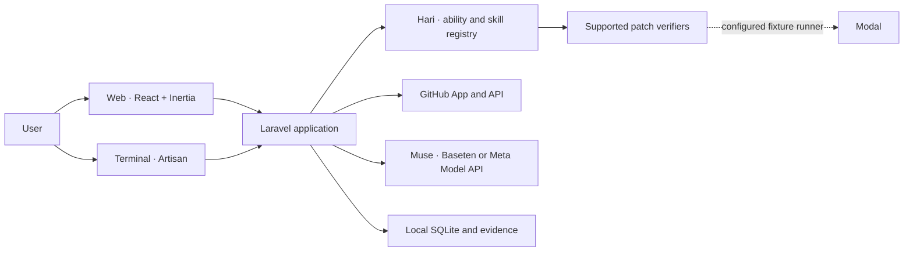

# ProofPatcher

**A local GitHub co-maintainer powered by Meta Muse.**

ProofPatcher helps maintainers inspect pull requests, find potential issues, and review suggested changes. It brings a GitHub workspace, model-assisted review, and verification tools together in a web app and terminal interface.

Built for the **Meta Global AI Developer Hackathon 2026**, Indie Developer track.

## What it does today

- **Connect GitHub** to browse repositories, issues, pull requests, and existing GitHub checks within the app's grant.
- **Review pull requests with Muse.** Opt-in autopilot polls enabled public repositories, saves findings, and skips revisions it already reviewed. A separate opt-in permits an automated inline comment on eligible public repositories. A maintainer can also request a review with a mention while the local mention listener is running. Bot comments require GitHub App credentials.
- **Work with issues and tasks.** Save local task cards, inspect supported issue content, and request suggestions in the available workflows. Attached screenshots are stored locally; they are not interpreted by Muse in this workflow.
- **Check a supported patch.** A visual verifier exercises included checkout examples. A separate, configured test-repository workflow can verify pinned candidates and create a draft pull request after the required checks and authorization.
- **Use the terminal.** The interactive menu and direct Artisan commands share connection state with the web app.

Model findings are suggestions: review them before acting. The application is an early local prototype, not a production service.

## Architecture



**Hari** is an in-process coordination core: abilities declare the skills they provide or use, and the registry checks those relationships. ProofPatcher is the application built on top. Hari is not a system kernel or a sandbox for untrusted code. See [Hari's design and boundaries](docs/HARI_KERNEL.md).

## Run locally

### Requirements

- PHP 8.4 or newer, with `gd`, `json`, SQLite, and the extensions required by Laravel and Composer.
- Composer, Node.js 20 or newer, and npm.
- Chrome or Chromium for the visual verification examples.
- The PHP `terminal` extension and an interactive terminal for `php artisan kernel`. A plain menu is available when ANSI color is disabled.

For a **new installation**, from the repository directory:

```bash
composer install
npm ci
cp .env.example .env
php artisan key:generate
touch database/proofpatch.sqlite
php artisan migrate
npm run build
php artisan serve --host=127.0.0.1 --port=8000
```

Open [http://127.0.0.1:8000](http://127.0.0.1:8000). For an existing installation, keep its `.env` and application key, and back up the SQLite database before migrations. Rolling back task-card migrations deletes those cards or their screenshots.

### Connect GitHub

Configure a GitHub App with a client ID and client secret, enable device flow for terminal use, and install the app on the repositories you want to access. For local web sign-in, register `http://127.0.0.1:8000/github/callback` as a callback URL, or use the callback corresponding to your configured `APP_URL`.

Set `PROOFPATCH_GITHUB_CLIENT_ID` and `PROOFPATCH_GITHUB_CLIENT_SECRET` in your private `.env`. Do not commit credentials. Choose **Sign in with GitHub** in the web app; the terminal uses GitHub's device authorization flow.

Select a Muse provider and add its key in Settings, or configure the appropriate provider key privately in the environment. The current app supports Baseten and Meta Model API configuration. Model requests may consume provider credits or incur charges; the local usage ledger is an estimate, not a provider billing limit. An optional `PROOFPATCH_MODEL_MAX_ATTEMPTS` setting limits local request attempts; autopilot also has optional limits in Settings.

### Terminal

```bash
# Open the interactive menu (requires the PHP terminal extension)
php artisan kernel

# Or use individual commands
php artisan github:connect
php artisan kernel:status
php artisan kernel:select-repo --list
php artisan kernel:reviews
```

To run a bounded automatic-review cycle, enable review for an authorized **public** repository and then run:

```bash
php artisan kernel:select-repo --enable-review owner/repository
php artisan kernel:autopilot --repo=owner/repository --minutes=1 --max-cycles=1
```

The worker runs only while the local machine and process are running. Automatic review does not process private pull requests. Automatic inline commenting requires its own explicit setting; enabling review alone does not enable comments. Bot posting additionally requires `PROOFPATCH_GITHUB_APP_ID` and an owner-only private key file outside the repository, referenced by `PROOFPATCH_GITHUB_APP_PRIVATE_KEY_PATH`. If the bot is not configured, it does not fall back to posting as the user. Reviews completed before bot setup are not automatically retried for posting.

For a maintainer-requested public PR review, independent of automatic review:

```bash
php artisan kernel:mentions --repo=owner/repository --minutes=10 --publish
```

After the listener reports that it is ready, a maintainer can post `@proofpatcher review` in the PR conversation. The listener checks the requester's access and the PR revision before reviewing and posting. Omit `--publish` to keep results local. This is a bounded, best-effort local listener, not a webhook: it does not process mentions while stopped, and issue or inline-thread mentions are not supported. `@pp review` is also recognized, but may notify an unrelated GitHub account.

## Scope and safeguards

- The visual verifier uses bundled checkout fixtures, not arbitrary selected pull requests. The dedicated issue-to-draft-PR workflow is restricted to its configured test repository and pinned inputs. Set `PROOFPATCH_TEST_REPO` and `PROOFPATCH_TEST_BASE_COMMIT` privately to enable the intended test case.
- Modal can run the configured pinned fixture checks when explicitly enabled. A successful result applies to the tested candidate and cases; it is not proof that arbitrary generated code is safe or correct. General untrusted-candidate verification remains disabled until its test-oracle boundary is established.
- A Git worktree is not a security sandbox. Do not run untrusted repository code on the host merely because it is in a worktree.
- Local task cards and images are not autonomous jobs. The app does not currently understand attached screenshots in the task-card workflow, or automatically solve and merge arbitrary issues.
- A snapshot digest or receipt supports integrity checking; it does not independently prove the origin, correctness, or safety of a change.

## Tests

```bash
./vendor/bin/phpunit
python3 -m unittest discover -s tests/Python -p 'test_*.py'
npm run typecheck
node --test tests/ui/*.test.mjs
npm run build
```

`composer drivers` can detect browser drivers for the Panther-based visual checks.

## License

[MIT](LICENSE)
